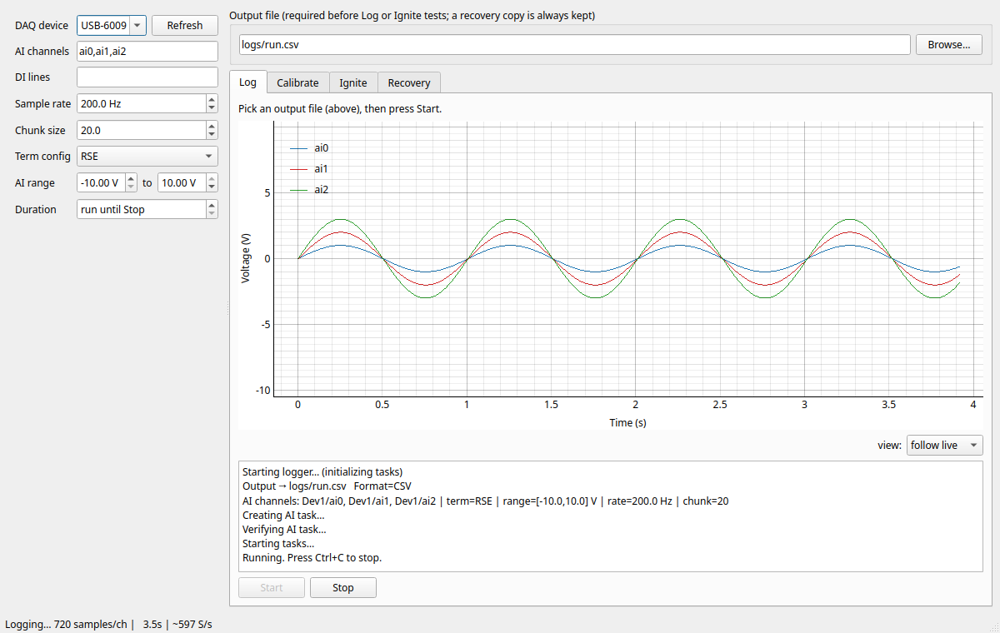

# NI USB-6009 Data Logger (Python)

Data logger for the NI USB-6009, written in Python using `nidaqmx`.  
Supports:

- Logging **analog inputs (AI)** and optional **digital inputs (DI)** to CSV or Excel (`.xlsx`).
- Live **progress counter / bar** while logging.
- **Safe filenames** (no overwrite; auto suffix).
- **Row timestamps** date each chunk back by its acquisition duration, so a row's
  time is when its sample was acquired, not when the read returned.
- **Calibration mode**: screen-only output with moving average filtering.
- **Ignition mode**: buzzer pre-warning, relay pulse, with **current-sense failsafe** using a shunt resistor.
- A **desktop GUI** (`ni_usb6009_gui`) with live plotting that offers all of the above; see [Graphical app](#graphical-app-gui).

**User manual:** [English](docs/USER-MANUAL.en.md) · [Nederlands](docs/USER-MANUAL.nl.md)

Tested on **Windows 10/11**, **Python 3.10/3.11**, with **NI-DAQmx runtime** installed.

---

## Graphical app (GUI)

Besides the command line, there is a stand-alone Windows desktop app,
`ni_usb6009_gui`, built on PySide6 and PyQtGraph. It has full parity with the CLI
(both share one core) and is aimed at operators who should not need a terminal.



*The Log tab mid-run. The screenshot was captured headless against the built-in
fake DAQ backend, so the sine waves are synthetic test data, not a real measurement.*

**What it offers**

- **Device auto-detection** with continuous monitoring: plug in the USB-6009 and it
  appears in the device box.
- **Config panel** (all modes): DAQ device, AI channels, DI lines, sample rate, chunk
  size, terminal config, AI range, duration.
- **Log tab**: logs AI/DI to CSV or XLSX with a **live plot** of every channel
  (follow live / pause view). An output file must be chosen first, and existing
  files are never overwritten.
- **Calibrate tab**: screen-only moving-average readout, no file written.
- **Ignite tab**: buzzer pre-warning and relay pulse with the same current-sense
  failsafes as the CLI, driven through an **ARM, hold-to-FIRE, ABORT** flow with
  status LEDs. Closing the window mid-run aborts safely and forces the DO lines LOW.
- **Recovery tab**: every logging run also writes a parallel recovery CSV; interrupted
  runs are listed so the partial data can be copied out.
- Settings persist between launches, and errors are shown as plain-language dialogs
  rather than tracebacks.

**Install and run**

```powershell
pip install -e .[gui,excel]
ni_usb6009_gui              # start the app
ni_usb6009_gui --selftest   # exit 0 = driver + device OK, 1 = no device, 2 = no driver
```

Windows users can instead use the Inno Setup installer built from
[`packaging/`](packaging/README.md) (Next-Next-Finish, optional silent NI-DAQmx
driver install). If the NI-DAQmx driver is missing, the app explains this and links to
the download page.

To try the GUI without hardware or a driver, set `NI_USB6009_FAKE=1` before starting
it (see *Testing without hardware* below).

Step-by-step operator instructions are in the [user manual](docs/USER-MANUAL.en.md)
(also [Dutch](docs/USER-MANUAL.nl.md)). Full behaviour is specified in the
[GUI functional specifications](GUI-functional-specifications-document.md).

---

## Installation

### Requirements
- NI-DAQmx driver/runtime from NI ([download](https://www.ni.com)).
- Python 3.10+ and `pip`.

### Python dependencies
Install into a virtual environment:

```powershell
python -m venv .venv
.\.venv\Scripts\activate

pip install nidaqmx numpy
pip install openpyxl   # required only for Excel output
```

### Local install (register CLI command)
From the project root (where `pyproject.toml` lives):

```powershell
python -m venv .venv
.\.venv\Scripts\activate
pip install -e .[excel]
```

This registers the command:

```powershell
ni_usb6009_logger --help
```

so you can call it directly without prefixing `python`.

### Using the venv

```powershell
cd "(path)\Test stand 2 (NI USB-6009)\ni-usb-6009-daq\ni_usb6009_logger"
.\.venv\Scripts\activate.bat
ni_usb6009_logger --help
```

When finished, deactivate the venv:

```powershell
deactivate
```


---

## Usage examples

### 1. Basic logging (AI only, CSV, auto-named file)
```powershell
ni_usb6009_logger --device Dev1 --channels ai0 --rate 1000 --term RSE --print-first 10
```

### 2. AI + DI logging (two AI, 4 DI lines on port0), custom CSV
```powershell
ni_usb6009_logger --device Dev1 --channels ai0,ai1 --digital port0/line0:3 ^
  --rate 100 --term RSE --outfile .\logs\run.csv --print-first 10
```

### 3. Log to Excel (`.xlsx`)
```powershell
ni_usb6009_logger --device Dev1 --channels ai0,ai1 --digital port0/line0:7 ^
  --rate 500 --term RSE --outfile .\logs\run.xlsx --print-first 10
```

### 4. Timed run (auto-stop after 30s)
```powershell
ni_usb6009_logger --device Dev1 --channels ai0 --rate 1000 --duration 30 --print-first 10
```

### 5. Differential wiring example
```powershell
ni_usb6009_logger --device Dev1 --channels ai0,ai1 --rate 1000 --term DIFF --print-first 10
```

### 6. Show live counter or progress bar
- Counter (default when no `--duration`):
```powershell
ni_usb6009_logger --device Dev1 --channels ai0 --rate 1000 --term RSE --progress counter --print-first 10
```

- Progress bar (useful with duration):
```powershell
ni_usb6009_logger --device Dev1 --channels ai0 --rate 1000 --term RSE --duration 30 --progress bar --print-first 10
```

### 7. Calibration mode (screen only, moving average)
```powershell
ni_usb6009_logger --device Dev1 --channels ai0,ai1 --calibrate --calib-window 5 ^
  --calib-sample-rate 100 --rate 1
  
ni_usb6009_logger --device Dev1 --channels ai0,ai1,ai2,ai3,ai4,ai5,ai6 --calibrate --calib-window 5 --calib-sample-rate 100 --rate 1 --term RSE

```

### 8. Ignition with buzzer + relay
```powershell
ni_usb6009_logger --device Dev1 --channels ai0 --digital port0/line0:7 --rate 1000 --term RSE ^
  --ignite --buzzer-line port1/line0 --igniter-line port1/line1 ^
  --arm-seconds 15 --stabilize-seconds 1 --pulse-seconds 1
```

### 9. Ignition with current-sense failsafe (shunt in RSE mode)
```powershell
ni_usb6009_logger --device Dev1 --channels ai0,ai2 --rate 1000 --term RSE ^
  --ignite --buzzer-line port1/line0 --igniter-line port1/line1 ^
  --igniter-sense-ai ai2 --sense-term RSE --shunt-ohms 1.0 ^
  --continuity-min-ma 0.2 --leak-max-ma 5 --fire-confirm-ma 300
```

> **Include the sense channel (`ai2` above) in `--channels`.** The USB-6009 has a
> single analog-input timing engine, so a second AI task cannot run next to the
> acquisition task. When the sense channel is logged, the fire-confirm value is taken
> from the running task's own samples (peak over the chunk covering the pulse). If it
> is not, the logger falls back to a separate task, which the driver may refuse — the
> pulse still completes, but the confirm reading is then reported as an error line.

### 10. My current test command
```powershell
ni_usb6009_logger --device Dev1 --channels ai0,ai1,ai2,ai3,ai4,ai5,ai6 --calibrate --calib-window 5 --calib-sample-rate 100 --rate 1 --term RSE --ignite --buzzer-line port1/line1 --igniter-line port1/line0 --igniter-sense-ai ai2 --sense-term RSE --shunt-ohms 1.0 --continuity-min-ma 0.2 --leak-max-ma 5 --fire-confirm-ma 300
```


---
## USB-6009 hardware limits

The logger checks these before it creates a DAQ task, so a mistake gives a
plain message and exit code 2 instead of a driver traceback:

| Limit | Value |
|---|---|
| Max sample rate | **48 kS/s aggregate**, shared across all AI channels. Logging 4 channels caps `--rate` at 12000. |
| Terminal config | **RSE** and **DIFF** only. The device has no NRSE mode, though `--term NRSE` parses. |
| Differential channels | **ai0-ai3** only. Differential wiring pairs the inputs, so ai4-ai7 are single-ended (RSE) only. |

Anything else the driver refuses is reported as `DAQ driver error:` followed by
NI's own text, which names the offending property and its permitted range.

### Testing without hardware

Two options, in increasing fidelity:

- `NI_USB6009_FAKE=1` swaps in an in-memory fake backend. No driver needed;
  good for GUI and file-format work. It ignores terminal config and rate
  limits, so it cannot catch the mistakes above.
- An **NI-DAQmx simulated device** (NI MAX -> Devices and Interfaces -> Create
  New -> NI-DAQmx Simulated Device -> USB-6009) goes through the real driver,
  with real error codes and real validation. Use this to verify anything that
  talks to the driver. AI returns a driver-generated sine and DO writes go
  nowhere physical, so ignition still needs the bench.

---
## Errors

When the app's status bar says **"NI configuration service not running"**, or
`--selftest` prints the same, the NI services are down — not the driver, and
not a missing device. Same fix as below:

```
nidaqmx.errors.DaqError: Internal Software Error occurred in MIG software. Please contact National Instruments Support.
```

Check if the correct NI services are running:

```powershell
Get-Service *NI* | Sort-Object Status, Name
Start-Service -Name "nidevldu","mxssvr","nimDNSResponder"  # as admin
```

Try restarting the _NI Configuration Manager_ service in Windows Control Panel, Administrative Tools, Services.

https://knowledge.ni.com/KnowledgeArticleDetails?id=kA00Z000000PAp0SAG


## Stopping a run

`Ctrl+C` requests a clean stop: the current chunk finishes, files close, and (in
ignition mode) the DO lines are forced LOW. A **second** `Ctrl+C` breaks out
immediately (exit code 130) if a DAQ read is wedged.

---

## Digital input notes (USB-6009)
- Digital inputs are **static** (not hardware-timed).  
- This script snapshots DI once per analog chunk and repeats the snapshot for each row in that chunk.  
- To increase the effective DI sampling frequency, lower `--chunk`.

---

## Ignition current-sense wiring (RSE mode)

### Components
- **Relay**: coil driven via DO + driver transistor (ULN2803, MOSFET). Contacts in series with igniter.  
- **Shunt resistor**: 1.0 Ω, ≥2 W, low inductance. Placed between igniter and ignition supply ground.  
- **Continuity bias resistor**: 47 kΩ (from +V to igniter/shunt node). Allows ~0.25 mA test current at 12 V.  

### Wiring
- **Ignition +V** → **Relay contact (NO)** → **Igniter +**  
- **Igniter –** → **1 Ω shunt** → **Ignition GND**  
- **Bias resistor 47 kΩ**: Ignition +V → igniter/shunt junction  
- **AI+ (e.g. Dev1/ai2)** → igniter/shunt junction  
- **AI GND** → ignition supply GND  

### Operation
- **Relay open**: only bias current flows (~0.25 mA @ 12 V → 0.25 mV across shunt). Used for continuity check.  
- **Relay closed**: full ignition current flows (3–6 A typical, → 3–6 V across shunt). Used for fire confirm.  
- **Software thresholds**:  
  - `--continuity-min-ma`: require ≥0.2 mA for continuity before arming.  
  - `--leak-max-ma`: inhibit if ≥5 mA before firing.  
  - `--fire-confirm-ma`: confirm if ≥300 mA during pulse. The confirm measurement
    range is derived from `fire-confirm-ma × shunt-ohms`, so multi-amp currents
    (3–6 V across a 1 Ω shunt) are not clipped.
  - A large **negative** sense current (reversed wiring) inhibits arming explicitly.

---

## Safety notes
- The USB-6009 **must never carry igniter current**. It only measures across the shunt.  
- Always drive relay coils with a **transistor or ULN2803**.  
- Add a **flyback diode** across the relay coil.  
- Fuse the ignition supply appropriately.  
- For maximum safety, keep ignition wiring and DAQ physically separated, or use **isolation** (opto or INA current-sense amplifier).  
- Always perform dry-runs with dummy loads before connecting real igniters.

---

## License
MIT (see [LICENSE](LICENSE))  
© 2025 David Steeman
